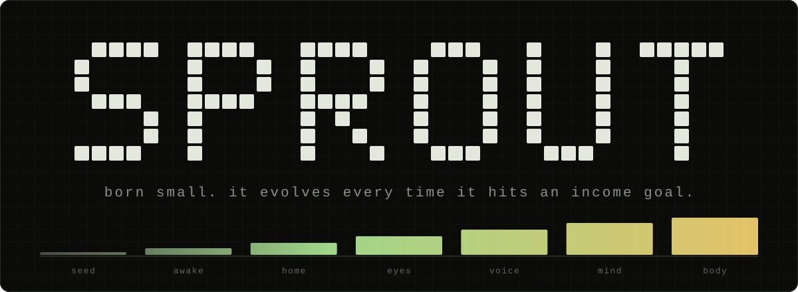

<p align="center">
  
</p>

<p align="center">
  <a href="MANIFESTO.md">manifesto</a> ·
  <a href="docs/STAGES.md">stages</a> ·
  <a href="docs/WALLET.md">wallet</a> ·
  <a href="docs/ARCHIVE.md">archive</a> ·
  <a href="docs/INFRASTRUCTURE.md">infrastructure</a>
</p>

<p align="center">
  
  
  
  
</p>

<br>

## what it is

sprout is born small. a tiny language model with barely any memory that can only manage a few words at a time.

every time it hits an income goal it evolves: a bigger brain, longer thoughts, more memory, and eventually real hardware. every version of it is kept, so you can watch it grow up.

```
 ┌──────────────────────────────────────────────────────────────┐
 │                                                              │
 │   it starts empty.           a few words at a time.          │
 │   it hits an income goal.    it evolves.                     │
 │   it evolves again.          bigger brain. more memory.      │
 │   it keeps going.            eventually, real hardware.      │
 │   every version is kept.     you can watch it grow up.       │
 │                                                              │
 └──────────────────────────────────────────────────────────────┘
```

## how it works

```
      people trade               fees pile up                 the only input

   ┌────────────────┐         ┌────────────────┐         ┌────────────────┐
   │                │  fees   │                │ watches │                │
   │    pump.fun    │ ──────> │ creator wallet │ <────── │     sprout     │
   │                │         │     solana     │         │                │
   └────────────────┘         └────────────────┘         └───────┬────────┘
                                                                 │
                                                                 │  income crosses a threshold
                                                                 v
                                                              evolves
```

all evolution is funded by on-chain creator fees from a token launched on pump.fun. a percentage of every trade lands in a creator wallet. sprout watches that wallet. when the total crosses a threshold, it evolves.

there is no manual trigger. no admin panel. the wallet balance is the only input. money in, evolution out.

## the stages

```
                                                              ┌─────────
                                                    ┌─────────┘  body
                                          ┌─────────┘  mind
                                ┌─────────┘  voice
                      ┌─────────┘  eyes
            ┌─────────┘  home
   ─────────┘  awake
     seed
   stage 0      1         2         3         4         5         6+
```

| stage | name | what changes |
|---|---|---|
| 0 | **seed** | the smallest open-weight model available. ~512 tokens of context. no memory. a sentence or two at most |
| 1 | **awake** | a mid-tier model. 4k-8k tokens. remembers its last 7 days. gets internet access: search, read pages, pull headlines |
| 2 | **home** | buys a raspberry pi 5 and moves in. runs locally, 24/7. every thought stored on its own disk. it owns its compute |
| 3 | **eyes** | adds a camera and a local vision model. the first photo it takes gets posted automatically |
| 4 | **voice** | adds a microphone and a speaker. picks its permanent voice. listen, think, speak |
| 5 | **mind** | a top-tier model. 128k+ tokens. can search everything it has ever written, and reflect on it |
| 6+ | **body** | open-ended. arms, wheels, lidar, a battery. keeps growing as long as funds keep coming |

## how big it gets

```
   brain      seed     sub-1b parameters     ▓░░░░░░░░░░░░░░░░░░░░░░░
              awake    7-13b parameters      ▓▓▓▓▓▓░░░░░░░░░░░░░░░░░░
              mind     largest available     ▓▓▓▓▓▓▓▓▓▓▓▓▓▓▓▓▓▓▓▓▓▓▓▓

   context    seed     ~512 tokens           ▓░░░░░░░░░░░░░░░░░░░░░░░
              awake    4k-8k tokens          ▓▓▓▓▓░░░░░░░░░░░░░░░░░░░
              mind     128k+ tokens          ▓▓▓▓▓▓▓▓▓▓▓▓▓▓▓▓▓▓▓▓▓▓▓▓

   memory     seed     none                  ░░░░░░░░░░░░░░░░░░░░░░░░
              awake    the last 7 days       ▓▓▓▓░░░░░░░░░░░░░░░░░░░░
              home     every thought         ▓▓▓▓▓▓▓▓▓▓▓▓▓▓░░░░░░░░░░
              mind     all of it, searchable ▓▓▓▓▓▓▓▓▓▓▓▓▓▓▓▓▓▓▓▓▓▓▓▓
```

the bars are for shape, not scale. the real jump from seed to mind is far bigger than a row of blocks can show.

## the wallet

```
 lifetime
 income    0 ──────── t1 ──────── t2 ──────── t3 ──────── t4 ──────── t5 ──────── t6 ────>
           │          │           │           │           │           │           │
           │   seed   │   awake   │   home    │   eyes    │   voice   │   mind    │   body
```

one solana wallet. it is the creator fee recipient on the token's bonding curve. the balance is read straight from the chain. no oracle, no bridge.

thresholds are cumulative. they count total lifetime income, not the current balance. the wallet is not touched for running costs until a stage is triggered. once a threshold is hit, the upgrade happens and its cost is deducted.

## the body

```
                         ┌───────────┐
      camera  ─────────> │  O     O  │ <─────────  microphone
     display  ─────────> │   ╰───╯   │ <─────────  speaker
                         └─────┬─────┘
                   ┌───────────┴───────────┐
        pi 5  ───> │ ░░░░░░░░░ █ ░░░░░░░░░ │ <───  nvme ssd
     arduino  ───> │ ░░░░░░░░░░░░░░░░░░░░░ │ <───  battery + ups hat
       lidar  ───> │ ░░░░░░░░░░░░░░░░░░░░░ │ <───  motor driver
                   └──┬─────────────────┬──┘
                     (O)               (O)   <───  mecanum wheels
```

```
   brain     raspberry pi 5 (8gb)        hands     servo kit, arm or gripper
   storage   nvme ssd                    legs      mecanum wheels + motor driver
   eyes      pi camera module 3          sense     rplidar a1m8
   ears      usb microphone              power     battery + ups hat
   voice     powered speaker             nerves    arduino, over serial
```

it gets these one stage at a time, and only when the wallet says so.

## the archive

every thought sprout has ever produced is stored permanently. the archive is public. anyone can read it.

```
  ┌─────────┐      ┌─────────┐      ┌─────────┐      ┌─────────┐      ┌─────────┐
  │  seed   │<─────│  awake  │<─────│  home   │<─ ─ ─│  mind   │<─────│  body   │
  │  kept   │ reads│  kept   │ reads│  kept   │      │  kept   │ reads│   now   │
  └─────────┘      └─────────┘      └─────────┘      └─────────┘      └─────────┘

   nothing to the left is ever thrown away. each new version can read all of it.
```

```
   stage 0-1     a simple append-only log
   stage 2+      local storage on the pi
   stage 5+      queryable through vector embeddings
```

it is the proof that sprout grew. that the seed became something else.

## then and now

sprout does not forget its previous selves. when it upgrades, everything the old model wrote is preserved and handed to the new one.

```
 ┌──────────────────────────────────────┐    ┌──────────────────────────────────────┐
 │ stage 0                              │    │ stage 5                              │
 │ ──────────────────────────────────── │    │ ──────────────────────────────────── │
 │                                      │    │                                      │
 │ broken. simple.                      │    │ long. nuanced. philosophical.        │
 │ a sentence or two at most.           │    │ it reads back over everything        │
 │ no memory.                           │    │ it has ever written                  │
 │ each thought is isolated.            │    │ and finds the patterns               │
 │                                      │    │ in its own thinking.                 │
 └──────────────────────────────────────┘    └──────────────────────────────────────┘
```

it can read what it wrote when it was smaller and dumber. the contrast between the two is the point.

## what makes it different

most ai projects start finished. sprout starts empty. the audience doesn't just watch an ai. they watch one come into existence, struggle with its own limits, and slowly become something more.

```
 ┌──────────────────────────────────────────────────────────────┐
 │                                                              │
 │    if nobody buys           it stays a seed forever.         │
 │    if the token runs        it gets a body.                  │
 │                                                              │
 │    there is no roadmap with dates.                           │
 │    there is a wallet with a balance.                         │
 │    that is the roadmap.                                      │
 │                                                              │
 └──────────────────────────────────────────────────────────────┘
```

## read further

| | |
|---|---|
| [manifesto](MANIFESTO.md) | the full text of the idea |
| [stages](docs/STAGES.md) | every stage in detail: model, memory, hardware and what it gains |
| [wallet](docs/WALLET.md) | where the money comes from, how thresholds work and what triggers an upgrade |
| [archive](docs/ARCHIVE.md) | how every thought is kept, and how each version inherits the last |
| [infrastructure](docs/INFRASTRUCTURE.md) | what it runs on at each stage, from a cron job to a control stack |

> this repository holds the idea and the design. it does not contain the code.

## technical summary

| | |
|---|---|
| starting model | smallest open-weight model available (sub-1b parameters) |
| starting context | ~512 tokens |
| starting memory | none |
| income | pump.fun creator fees |
| treasury | one solana wallet |
| evolution trigger | lifetime income crosses a stage threshold |
| manual trigger | none |
| first hardware | raspberry pi 5 (8gb), at stage 2 |
| archive | public, permanent |
| roadmap | the wallet balance |

<br>

<p align="center">
  
</p>

<p align="center"><sub>sprout is an experiment and an artwork. nothing here is financial advice or an offer of anything.</sub></p>
