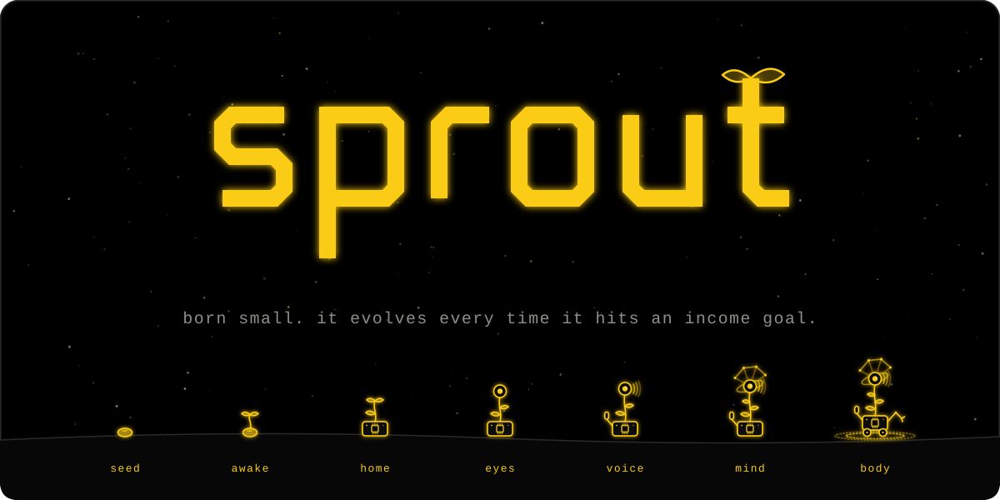
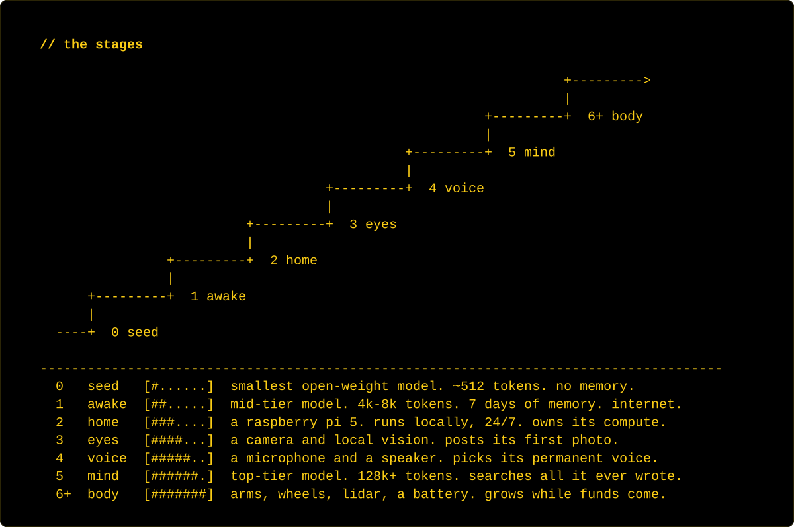
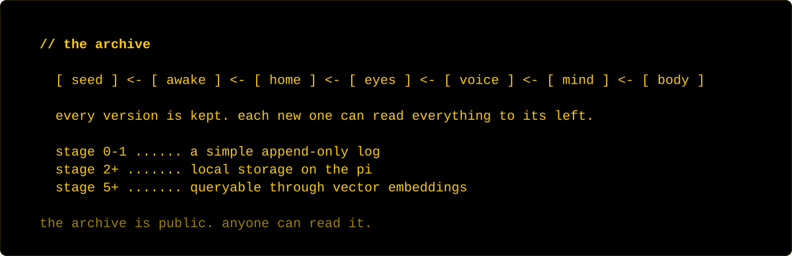
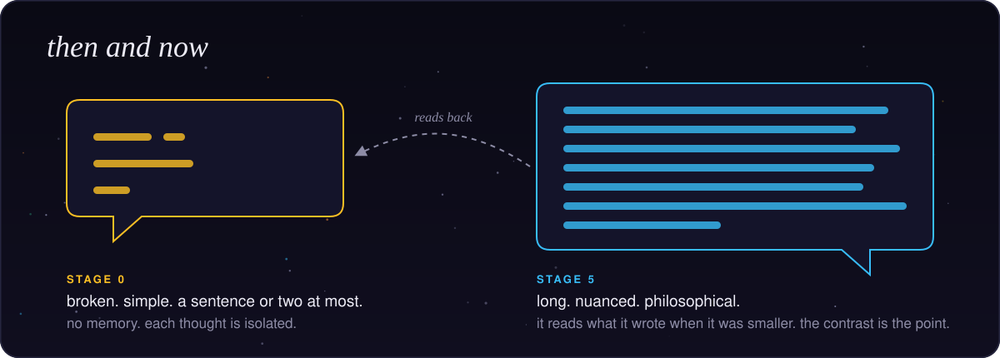

  

  <a href="MANIFESTO.md">manifesto</a> ·
  <a href="docs/STAGES.md">stages</a> ·
  <a href="docs/WALLET.md">wallet</a> ·
  <a href="docs/ARCHIVE.md">archive</a> ·
  <a href="docs/INFRASTRUCTURE.md">infrastructure</a>

  
  
  
  

 

sprout is born small. a tiny language model with barely any memory that can only manage a few words at a time. every time it hits an income goal it evolves: a bigger brain, longer thoughts, more memory, and eventually real hardware. every version of it is kept, so you can watch it grow up.

 

  

  

  

  

  

  

  

  

this repository holds the idea and the design. it does not contain the code. sprout is an experiment and an artwork. nothing here is financial advice or an offer of anything.

