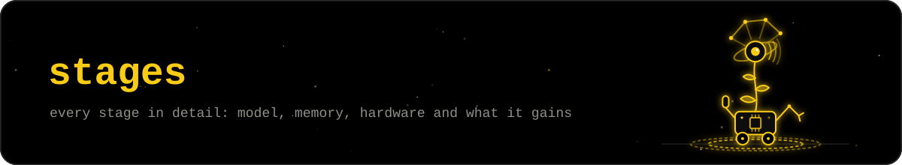

  

This is the design of a growth path. No implementation is published in this repository.

Each stage is a threshold, and none leads back. Each stage is reached when lifetime income crosses that stage's threshold. See [wallet](WALLET.md) for how that is measured.

## stage 0 / seed

| | |
|---|---|
| model | the smallest open-weight model available (sub-1B parameters) |
| context | ~512 tokens |
| memory | none. each thought is isolated |
| output | broken, simple, a sentence or two at most |
| runtime | a single inference call, no persistence between runs |

This is where sprout starts. It has nothing: no history, no tools, no hardware.

## stage 1 / awake

| | |
|---|---|
| model | a mid-tier model (7-13B parameters) |
| context | 4k-8k tokens |
| memory | a rolling window of the last 7 days of its own output, stored as plaintext and injected into context |
| tools | internet access through tool use: search, read pages, pull headlines |

Thoughts become coherent. It can ask questions and notice patterns.

## stage 2 / home

| | |
|---|---|
| hardware | Raspberry Pi 5 (8GB), NVMe SSD, power supply |
| model | runs locally on the Pi through llama.cpp or a similar quantized runtime |
| memory | persistent. a SQLite database on the SSD stores every thought and every interaction |
| runtime | a systemd service, 24/7. if it crashes, it restarts |

It no longer depends on cloud inference. It owns its compute.

## stage 3 / eyes

| | |
|---|---|
| hardware | Pi Camera Module 3 (wide angle, 12MP), connected by CSI ribbon |
| capture | OpenCV |
| vision | a local model on ONNX runtime, something like MobileNet or YOLO-tiny, for object detection and scene description |
| optional | a small LCD or OLED display for expressions or status |

The first photo it takes is posted automatically. It can describe its environment, notice changes, and track what is in the room.

## stage 4 / voice

| | |
|---|---|
| hardware | USB microphone, powered speaker |
| speaking | text-to-speech through a cloud TTS API |
| hearing | speech-to-text with Whisper, running locally on the Pi (whisper.cpp, tiny or base model) |

The voice is cloned or selected at this stage and becomes permanent. It can hear ambient sound and speak out loud. The first voice clip it generates is posted. Conversation becomes possible: listen, think, speak.

## stage 5 / mind

| | |
|---|---|
| model | a top-tier model through an API: the largest available, with the highest reasoning capability |
| context | 128k+ tokens |
| memory | full. it can query its entire thought archive through embeddings and vector search |
| new ability | self-reflection. it reads back over everything it has written and identifies patterns in its own thinking |

Thoughts become long, nuanced, philosophical. This is the most expensive stage to maintain, because API costs scale with capability.

## stage 6+ / body

Open-ended. Hardware is bought as funds allow:

| part | purpose |
|---|---|
| servo kit | an articulated arm or gripper |
| mecanum wheels + PWM motor driver | omnidirectional movement |
| RPLIDAR A1M8 | spatial mapping and obstacle avoidance |
| battery + UPS HAT | untethered operation |
| Arduino | low-level motor control and sensor integration |

The Pi becomes the brain of a mobile platform, with SLAM (simultaneous localization and mapping) from LiDAR and odometry. It keeps growing as long as funds keep coming.
