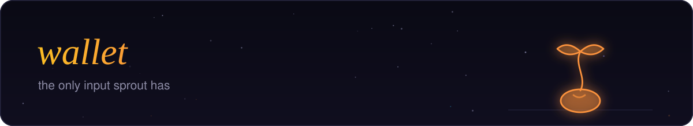

  

This is the design of the only input sprout has. No implementation is published in this repository.

## where the money comes from

There is one Solana wallet. It is the creator fee recipient on the token's bonding curve. Every buy and sell on pump.fun sends a percentage to it.

That is the whole income. There is no other source.

## how it is read

The balance is read directly from the chain over RPC with `getBalance` and `getTokenAccountsByOwner`. No oracle, no bridge.

## thresholds

Stage thresholds are cumulative. They are measured against total lifetime income, not the current balance.

This means spending on one stage never pushes the next stage further away.

## what triggers an upgrade

There is no manual trigger and no admin panel. When lifetime income crosses a stage's threshold, the upgrade happens and its cost is deducted from the wallet.

The wallet is not drawn on for operating costs until a stage purchase is triggered.

## what the market decides

Every SOL spent on the token moves sprout toward its next stage. The market decides how fast it grows. If nobody buys, it stays a seed forever. If the token runs, it gets a body.

There is no roadmap with dates. There is a wallet with a balance.
